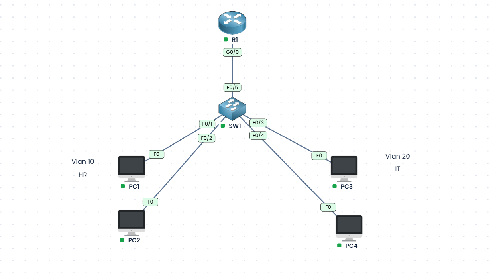

# VLAN and Inter-VLAN Routing Lab

## Overview

This project demonstrates VLAN segmentation and inter-VLAN routing using a router-on-a-stick configuration in the PingMyNetwork sandbox.

The network separates two departments, HR and IT, into different VLANs and uses a router to enable communication between their IP subnets.

## Objectives

- Create and configure VLAN 10 (HR) and VLAN 20 (IT).
- Assign switch access ports to the appropriate VLANs.
- Configure a trunk link between the switch and router.
- Configure router subinterfaces using IEEE 802.1Q encapsulation.
- Assign IP addresses and default gateways to end devices.
- Test connectivity within and between VLANs.

## Network Topology

The lab contains:

- 1 router: R1 (ISR4331)
- 1 switch: SW1 (Cisco Catalyst 2960)
- 4 PCs: PC1, PC2, PC3, and PC4

### VLAN Design

| VLAN ID | VLAN Name | Network Address |
|---|---|---|
| 10 | HR | 192.168.1.0/24 |
| 20 | IT | 192.168.2.0/24 |

## IP Addressing Table

| Device | VLAN | IP Address | Subnet Mask | Default Gateway |
|---|---|---|---|---|
| PC1 | 10 (HR) | 192.168.1.10 | 255.255.255.0 | 192.168.1.1 |
| PC2 | 10 (HR) | 192.168.1.11 | 255.255.255.0 | 192.168.1.1 |
| PC3 | 20 (IT) | 192.168.2.10 | 255.255.255.0 | 192.168.2.1 |
| PC4 | 20 (IT) | 192.168.2.11 | 255.255.255.0 | 192.168.2.1 |

## Switch Configuration

The switch is configured with two VLANs:

- VLAN 10 — HR
- VLAN 20 — IT

### Port Assignments

| Switch Port | Connected Device | Mode | VLAN |
|---|---|---|---|
| FastEthernet0/1 | PC1 | Access | 10 |
| FastEthernet0/2 | PC2 | Access | 10 |
| FastEthernet0/3 | PC3 | Access | 20 |
| FastEthernet0/4 | PC4 | Access | 20 |
| FastEthernet0/5 | Router R1 | Trunk | 10 and 20 |

The trunk carries traffic for both VLANs between the switch and router.

## Router Configuration

Router-on-a-stick routing is implemented using two subinterfaces on R1's GigabitEthernet0/0 interface.

| Router Interface | VLAN | IP Address |
|---|---|---|
| GigabitEthernet0/0.10 | 10 | 192.168.1.1/24 |
| GigabitEthernet0/0.20 | 20 | 192.168.2.1/24 |

IEEE 802.1Q encapsulation is configured on each subinterface to identify traffic belonging to its respective VLAN.

The router subinterface IP addresses serve as the default gateways for the two networks.

## Verification and Testing

The sandbox export contains recorded ping tests showing successful communication in the following cases:

- PC1 (192.168.1.10) to PC2 (192.168.1.11): same-VLAN connectivity.
- PC3 (192.168.2.10) to PC4 (192.168.2.11): same-VLAN connectivity.
- PC1 (192.168.1.10) to PC3 (192.168.2.10): inter-VLAN connectivity.
- PC3 (192.168.2.10) to the gateway 192.168.1.1: connectivity to the other VLAN's gateway.

Some initial ping attempts timed out before later successful replies were recorded. The results should therefore be interpreted alongside the final configuration and verification state.

### Useful Verification Commands

```text
show vlan brief
show interfaces trunk
show ip interface brief
show running-config
```

These commands can be used to inspect VLAN membership, trunk operation, router interface status, and device configurations.


## Network Topology

The following screenshot shows the VLAN 10 (HR) and VLAN 20 (IT) network configured in the simulation sandbox.



## Files

- `Vlan_and_Inter_Vlan_Routing.json` — exported network simulation containing the topology, device configuration data, and recorded command/test history.
- `vlan-topology.png` — Network topology screenshot showing VLAN 10 (HR), VLAN 20 (IT), the router, switch, and connected PCs.

## Learning Outcomes

This lab provides practical experience with:

- VLAN creation and network segmentation.
- Switch access ports and trunk links.
- Router-on-a-stick inter-VLAN routing.
- IPv4 addressing and default gateway configuration.
- Connectivity verification and basic troubleshooting.

## Conclusion

The lab demonstrates how VLANs can separate departmental networks while router-on-a-stick routing enables communication between their IP subnets. The exported simulation provides a record of the topology, configuration, and connectivity tests.
